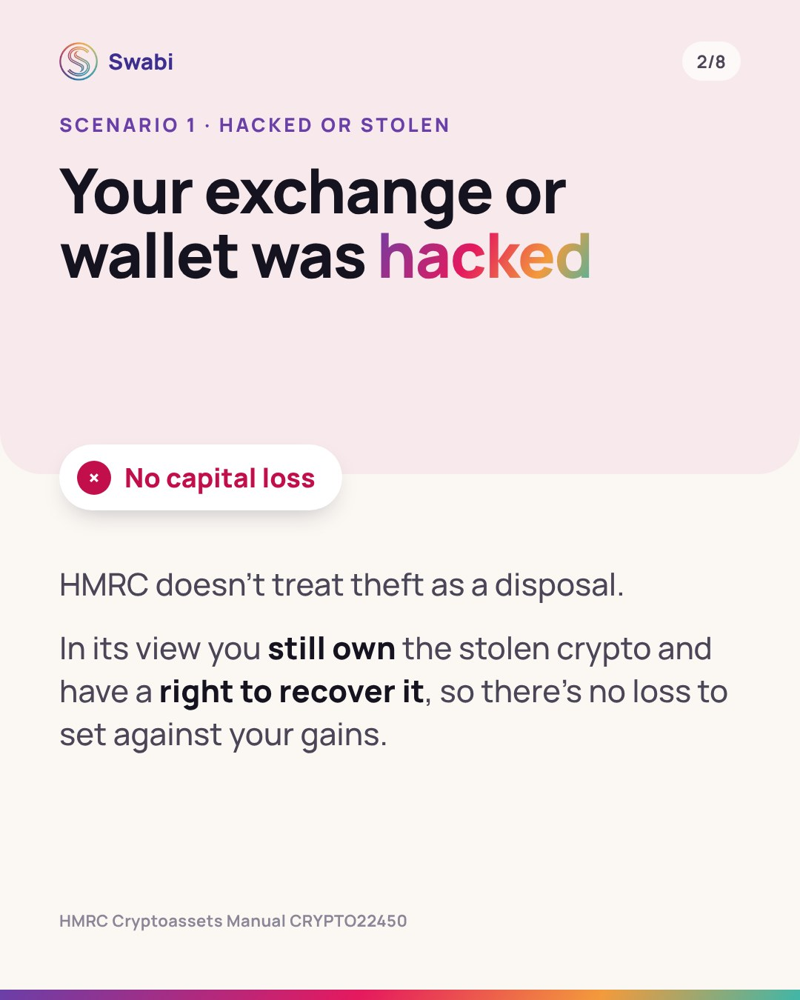
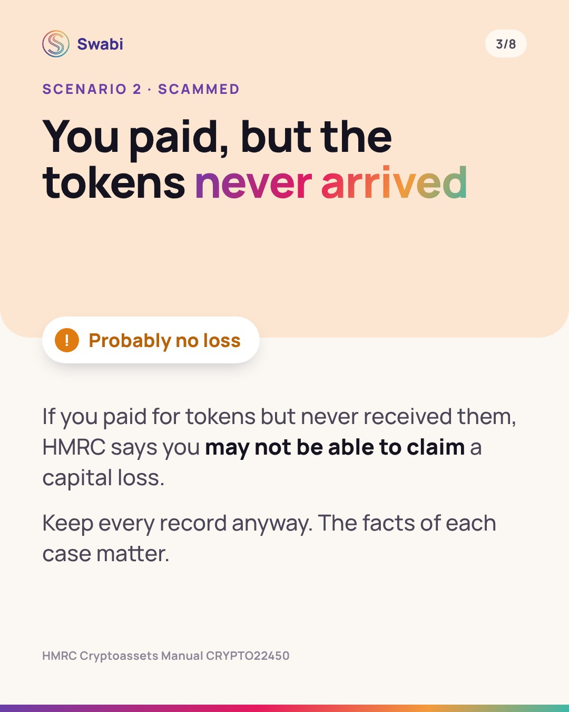
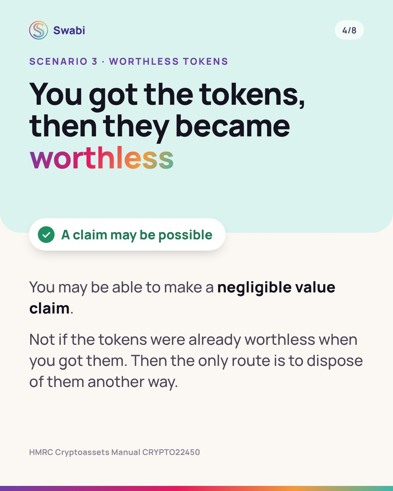
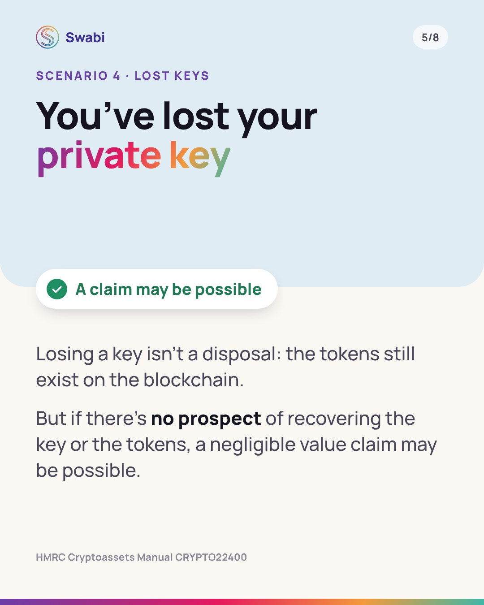
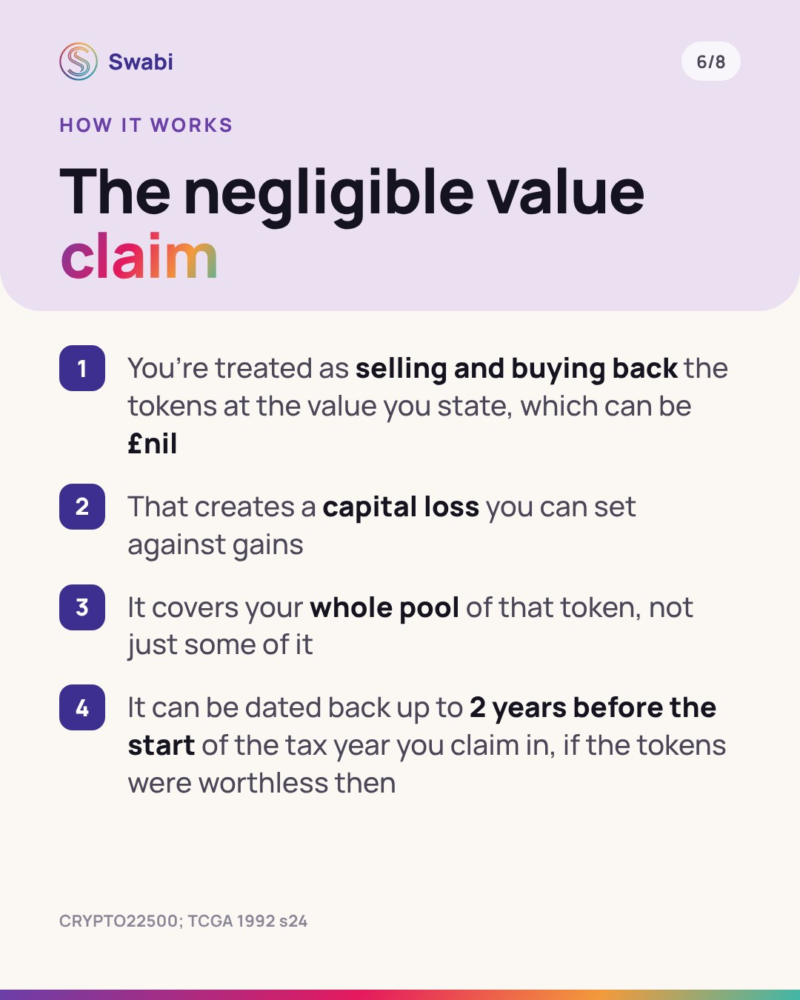
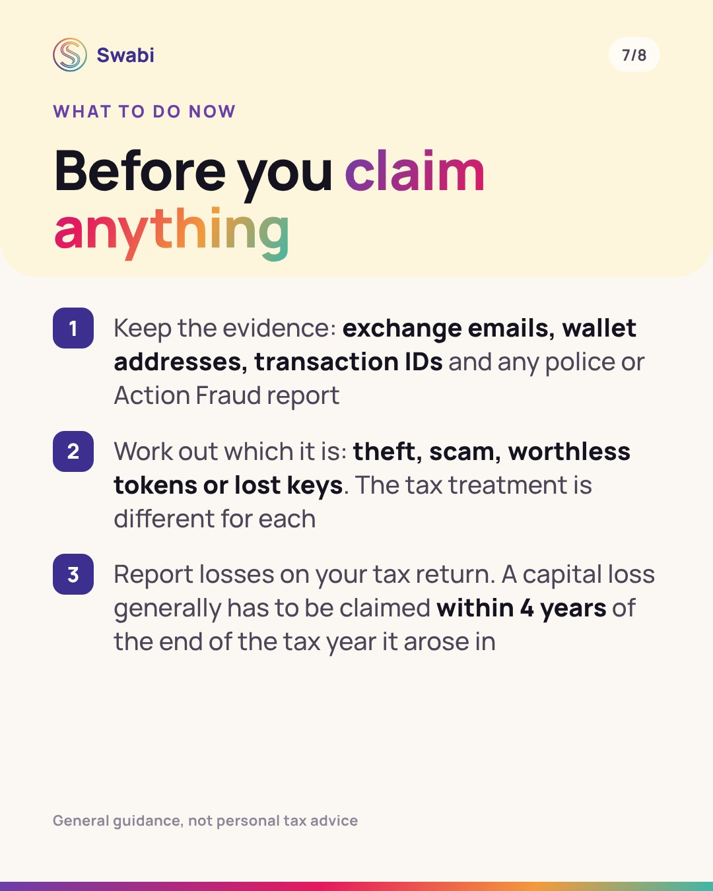

If your crypto was taken in a hack or a scam, it's natural to assume you can at least claim it as a loss for Capital Gains Tax. In most cases you can't. But depending on what happened, a negligible value claim may still help.

<!--more-->

## Hacked or stolen: no capital loss

HMRC doesn't treat theft as a disposal. In its view you still own the stolen crypto and have a right to recover it, so there is no loss to set against your gains.

## Scammed: it depends what you received

If you paid for tokens but never received them, HMRC says you may not be able to claim a capital loss.

If you did receive tokens and they later became worthless, you may be able to make a negligible value claim. That isn't allowed if the tokens were already worthless when you got them. In that case the only way to crystallise the loss is to dispose of them another way.

## Lost your private key

Losing a private key isn't a disposal either, because the tokens still exist on the blockchain. But if there's no prospect of recovering the key or the tokens, a negligible value claim may be possible.

## How a negligible value claim works

- You're treated as selling and buying back the tokens at the value you state, which can be £nil.
- That creates a capital loss you can set against gains.
- Because crypto is pooled, the claim covers your whole pool of that token.
- The claim can be dated back up to two years before the start of the tax year you make it in, as long as the tokens were already worthless at that earlier date.

## What to do now

- Keep the evidence: exchange emails, wallet addresses, transaction IDs and any police or Action Fraud report.
- Work out which situation you're in: theft, a scam, worthless tokens or lost keys. The tax treatment is different for each.
- Report any loss on your tax return. A capital loss generally has to be claimed within four years of the end of the tax year it arose in.

This is general guidance, not personal tax advice. If you've lost crypto and aren't sure what you can claim, [get in touch](/#contact) and we'll help you work it out.

## Sources

- [HMRC Cryptoassets Manual CRYPTO22400: losing private keys](https://www.gov.uk/hmrc-internal-manuals/cryptoassets-manual/crypto22400)
- [HMRC Cryptoassets Manual CRYPTO22450: being defrauded](https://www.gov.uk/hmrc-internal-manuals/cryptoassets-manual/crypto22450)
- [HMRC Cryptoassets Manual CRYPTO22500: S24 and negligible value](https://www.gov.uk/hmrc-internal-manuals/cryptoassets-manual/crypto22500)
