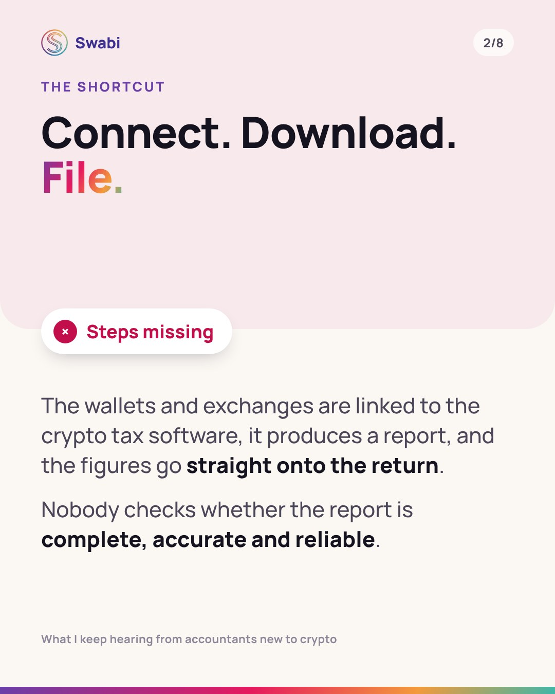
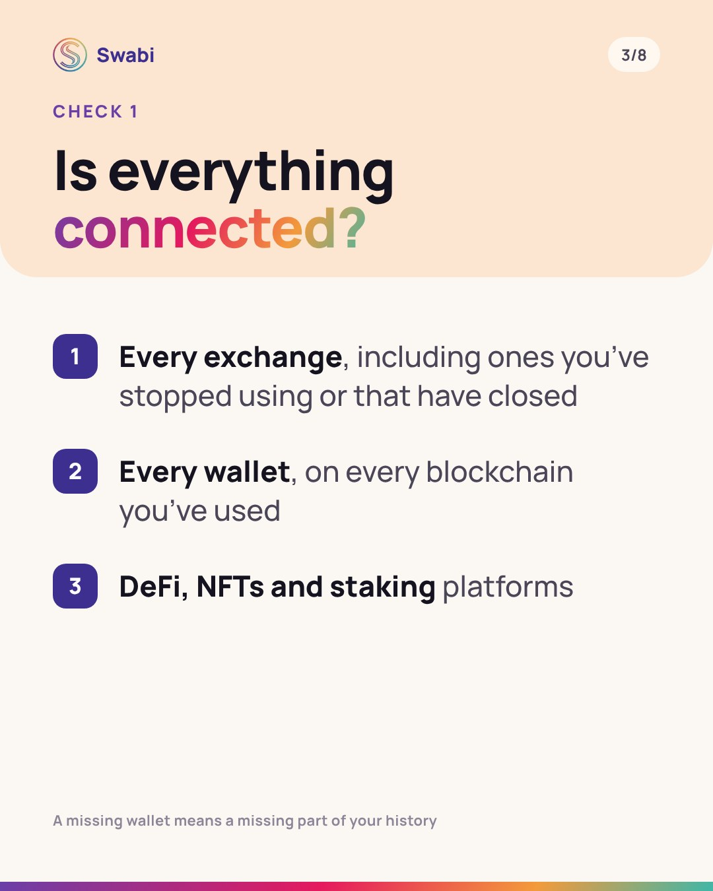
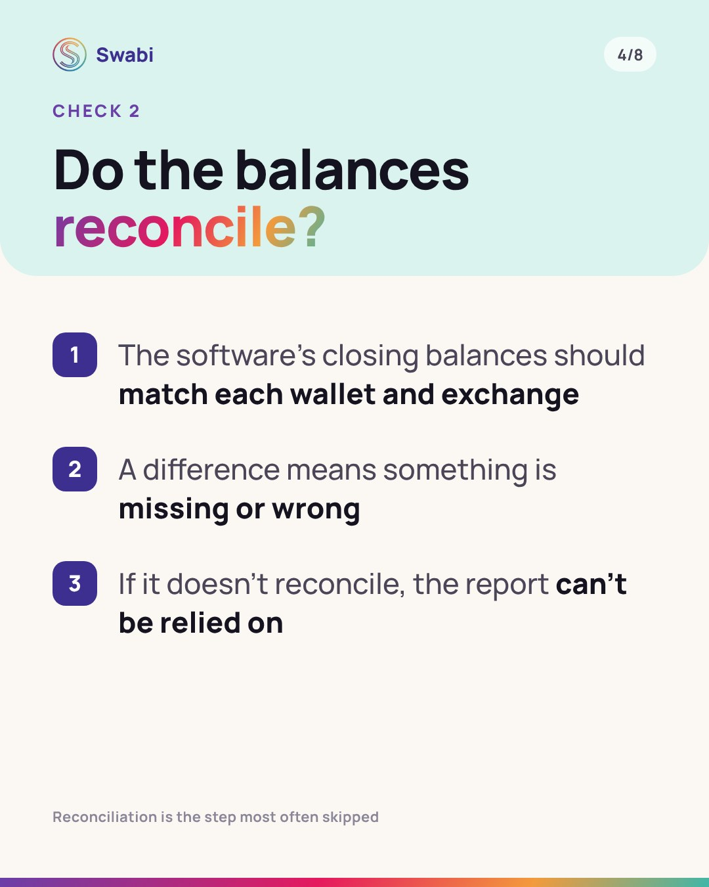
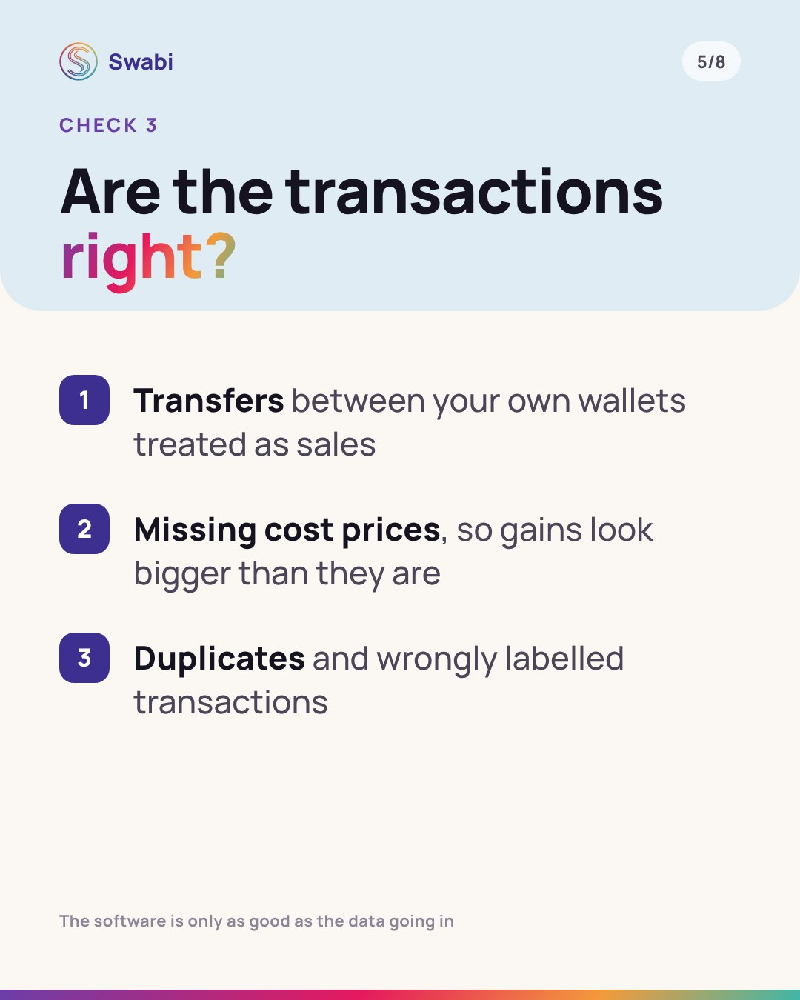
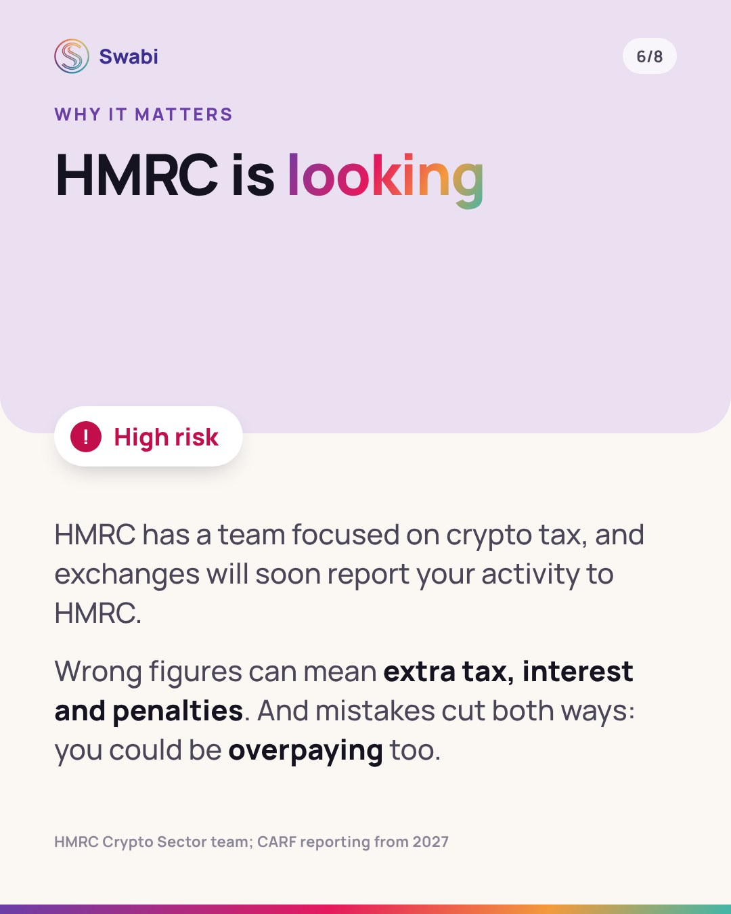
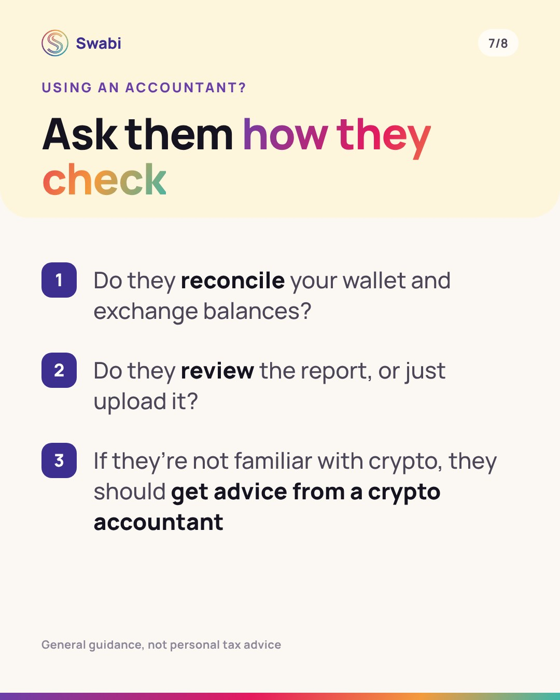

I've spoken to a lot of accountants who aren't familiar with crypto. Many of them work the same way: the client's wallets and exchanges are connected to software like Koinly, the software produces a report, and that report goes straight into the Self Assessment return.

<!--more-->

What's missing is everything in between. The software is only as good as the data going in. If nobody checks that the report is complete, accurate and reliable, the figures on your return could be wrong, in either direction.

## Check 1: is everything connected?

Every exchange needs to be included, even ones you've stopped using or that have closed. So does every wallet, on every blockchain, along with any DeFi, NFT or staking platforms. A missing wallet means a missing part of your history.

## Check 2: do the balances reconcile?

The closing balances in the software should match the real balances in each wallet and exchange. A difference means something is missing or wrong. If the report doesn't reconcile, it can't be relied on, and this is the step most often skipped.

## Check 3: are the transactions right?

- Transfers between your own wallets can be treated as sales.
- Missing cost prices make gains look bigger than they are.
- Duplicates and wrongly labelled transactions distort the figures.

## Why it matters

HMRC has a team focused on crypto tax, and exchanges will soon report your activity to HMRC under the Cryptoasset Reporting Framework. Wrong figures can mean extra tax, interest and penalties. And mistakes cut both ways: you could be overpaying too.

## Using an accountant?

Ask them how they check the report. Do they reconcile your wallet and exchange balances? Do they review the report, or just upload it? If they're not familiar with crypto, they should get advice from a crypto accountant.

This is general guidance, not personal tax advice. If you're not sure your crypto figures are right, [get in touch](/#contact) and we'll check them for you.
